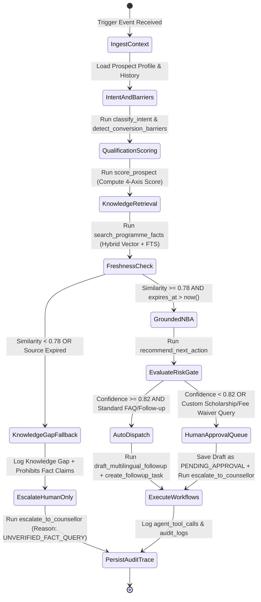

# 03 — System & Agent Architecture Diagrams: SIGNAL

**Document Version:** 1.0.0  
**Scope:** High-Level System Topology, Supervisor Agent Execution Loop, RAG Verification Pipeline, and Realtime Event Flow

---

## 1. End-to-End Platform Topology

```
+---------------------------------------------------------------------------------------------------+
|                                   EXTERNAL ACQUISITION & CHANNELS                                 |
|  [Web Intake / Micro-Forms]   [WhatsApp Cloud API]   [Resend Email]   [Meta/Google Lead Webhooks] |
+--------------+-------------------------+--------------------+----------------------+--------------+
               |                         |                    |                      |
               v                         v                    v                      v
+---------------------------------------------------------------------------------------------------+
|                           NEXT.JS 15 APP ROUTER (EDGE & SERVER LAYER)                             |
|                                                                                                   |
|  +---------------------------+   +----------------------------+   +----------------------------+  |
|  | Security & Validation     |   | REST & Webhook API Layer   |   | UI Presentation Layer      |  |
|  | - Zod Schema Validation   |   | - /api/v1/prospects        |   | - Command Centre (WebGL)   |  |
|  | - HMAC Webhook Verifier   |   | - /api/v1/agent/execute    |   | - Prospect Explorer & 360  |  |
|  | - Rate Limiter            |   | - /api/v1/knowledge/search |   | - Agent Control Room       |  |
|  | - Consent Gatekeeper      |   | - /api/v1/communications   |   | - Engagement Studio        |  |
|  | - Supabase Auth JWT/RBAC  |   | - /api/v1/conversions      |   | - Counsellor Workspace     |  |
|  +-------------+-------------+   +--------------+-------------+   +--------------+-------------+  |
+----------------|--------------------------------|--------------------------------|----------------+
                 |                                |                                |
                 |                                v                                |
                 |        +-----------------------------------------------+        |
                 |        |       SIGNAL SUPERVISOR AGENT ORCHESTRATOR    |        |
                 |        |         (OpenAI Agents SDK + Guardrails)      |        |
                 |        |                                               |        |
                 |        |  1. score_prospect                            |        |
                 |        |  2. classify_intent                           |        |
                 |        |  3. detect_conversion_barriers                |        |
                 |        |  4. search_programme_facts (Hybrid pgvector)  |        |
                 |        |  5. recommend_next_action                     |        |
                 |        |  6. draft_multilingual_followup               |        |
                 |        |  7. create_followup_task                      |        |
                 |        |  8. escalate_to_counsellor                    |        |
                 |        |  9. record_conversion_event                   |        |
                 |        +-----------------------+-----------------------+        |
                 |                                |                                |
                 v                                v                                v
+---------------------------------------------------------------------------------------------------+
|                         SUPABASE DATA, VECTOR & REALTIME PLATFORM (POSTGRES 16)                   |
|                                                                                                   |
|  +------------------------+  +-------------------------+  +------------------------------------+  |
|  | Core Entities          |  | AI & Knowledge Store    |  | Execution & Conversion Spine       |  |
|  | - prospects            |  | - programme_knowledge   |  | - agent_runs                       |  |
|  | - prospect_profiles    |  |   (vector(1536) + FTS)  |  | - agent_tool_calls                 |  |
|  | - lead_assessments     |  | - knowledge_sources     |  | - conversion_events                |  |
|  | - communications       |  |   (TTL & freshness)     |  | - experiments                      |  |
|  | - followup_tasks       |  |                         |  | - audit_logs (Immutable)           |  |
|  | - counsellor_users     |  |                         |  | - Supabase Realtime Broadcast      |  |
|  +------------------------+  +-------------------------+  +------------------------------------+  |
+-------------------------------------------------+-------------------------------------------------+
                                                  |
                                                  v
+---------------------------------------------------------------------------------------------------+
|                          AUTOMATION, INGESTION & OBSERVABILITY LAYER                              |
|  [n8n Workflow Engine: Drip Timers, SLA Alerts]   [Firecrawl: Official URL Scraper]   [Sentry/PH] |
+---------------------------------------------------------------------------------------------------+
```

---

## 2. Autonomous Prospect-to-Action Execution Flow (Sequence Diagram)

```mermaid
sequenceDiagram
    autonumber
    actor Student as Prospective Student
    participant Intake as Acquisition Studio / Webhook
    participant API as Next.js API (/api/v1/agent/execute)
    participant Agent as SIGNAL Supervisor Agent
    participant VectorDB as Supabase Postgres + pgvector
    participant Guardrail as Policy & Grounding Verifier
    participant Channel as WhatsApp / Resend / Counsellor Queue
    participant UI as Realtime UI (Control Room & 360)

    Student->>Intake: Submits inquiry ("Is B.Tech AI eligible without Math in 12th? Also need EMI options")
    Intake->>VectorDB: Upsert `prospects` + `prospect_profiles` + `conversion_events(LEAD_CAPTURED)`
    Intake->>API: Trigger Agent Run (prospect_id, trigger="INBOUND_INQUIRY")
    API->>VectorDB: Create `agent_runs` (status="RUNNING")
    VectorDB-->>UI: Realtime push: Agent Run Started

    API->>Agent: Invoke Supervisor Loop with Prospect Context
    
    rect rgb(15, 23, 42)
        Note over Agent,VectorDB: Phase 1: Intelligence & Qualification
        Agent->>VectorDB: Tool 1: `classify_intent` -> "ELIGIBILITY_AND_FINANCING_INQUIRY"
        Agent->>VectorDB: Tool 2: `detect_conversion_barriers` -> ["ELIGIBILITY_DOUBT", "FEE_ANXIETY"]
        Agent->>VectorDB: Tool 3: `score_prospect` -> Fit: 78, Intent: 88, Readiness: 72, Friction: 65 (Tier: HOT)
        VectorDB-->>UI: Realtime push: Tool Call Traces #1, #2, #3
    end

    rect rgb(15, 40, 50)
        Note over Agent,VectorDB: Phase 2: Verified Knowledge Retrieval (Zero Hallucination)
        Agent->>VectorDB: Tool 4: `search_programme_facts` (queries: ["B.Tech AI eligibility 12th math", "B.Tech AI fee EMI scholarship"])
        VectorDB-->>Agent: Verified Chunks (source_id, verified_at, expires_at > now(), similarity: 0.91)
        VectorDB-->>UI: Realtime push: Tool Call Trace #4 (Citations attached)
    end

    rect rgb(30, 20, 55)
        Note over Agent,Guardrail: Phase 3: Next-Best-Action & Grounded Drafting
        Agent->>VectorDB: Tool 5: `recommend_next_action` -> "SEND_WHATSAPP_FOLLOWUP" + "ESCALATE_COUNSELLOR_CALL"
        Agent->>Guardrail: Tool 6: `draft_multilingual_followup` (lang="hinglish", citations=[chunk_01, chunk_04])
        Guardrail->>Guardrail: Verify 100% numeric figures match retrieved chunks & consent_whatsapp == true
        Guardrail-->>VectorDB: Insert `communications` + `followup_tasks` + `escalate_to_counsellor`
    end

    VectorDB->>Channel: Dispatch WhatsApp response / Notify Counsellor Workspace
    Agent->>VectorDB: Update `agent_runs` (status="COMPLETED", total_duration_ms, confidence_score)
    VectorDB-->>UI: Realtime push: Run Completed + Prospect 360 Updated
```



---

## 3. Supervisor Agent Decision & Guardrail State Machine



---

## 4. Closed-Loop Conversion & Growth Feedback Architecture

```
+-----------------------------------------------------------------------------------+
|                        PROSPECT ACQUISITION & ATTRIBUTION                         |
|   UTM Source / Medium / Campaign  +  Landing Page Variant  +  Initial Intent      |
+-----------------------------------------+-----------------------------------------+
                                          |
                                          v
+-----------------------------------------------------------------------------------+
|                        4-AXIS AI QUALIFICATION & FRICTION MAP                     |
|   Fit (0-100)  |  Intent (0-100)  |  Readiness (0-100)  |  Friction Barriers []   |
+-----------------------------------------+-----------------------------------------+
                                          |
                                          v
+-----------------------------------------------------------------------------------+
|                        NBA INTERVENTION & EXPERIMENT COHORT                       |
|   Experiment Variant A (Immediate WhatsApp EMI Breakdown) vs Variant B (Call)     |
+-----------------------------------------+-----------------------------------------+
                                          |
                                          v
+-----------------------------------------------------------------------------------+
|                        TERMINAL CONVERSION EVENT RECORDING                        |
|   record_conversion_event: APPLICATION_STARTED -> OFFER_ISSUED -> FEE_PAID        |
+-----------------------------------------+-----------------------------------------+
                                          |
                                          v
+-----------------------------------------------------------------------------------+
|                        CONVERSION FEEDBACK ENGINE (ANALYTICS)                     |
|   1. Recomputes Source-to-Enrollment LTV & Cost-Per-Verified-Applicant            |
|   2. Updates Experiment Bayesian Lift & Statistical Confidence                    |
|   3. Surfaces Top Unresolved Friction Barriers to Programme Knowledge Team        |
+-----------------------------------------------------------------------------------+
```
